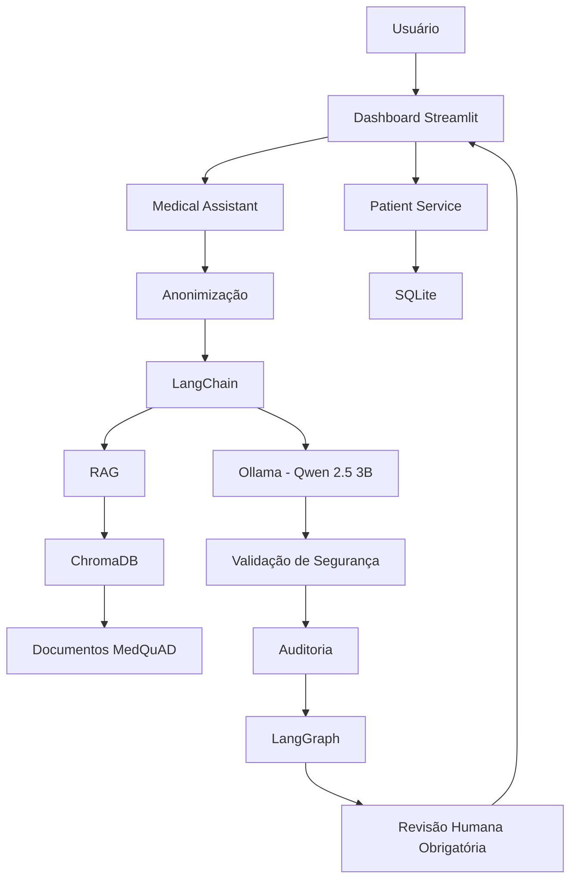

# Medical AI Assistant

Assistente de informação médica baseado em Inteligência Artificial Generativa, RAG (Retrieval-Augmented Generation), LangChain e LangGraph.

O projeto foi desenvolvido como solução acadêmica para demonstrar recuperação de informações médicas, geração de respostas com modelos locais, integração com dados fictícios de pacientes, anonimização, auditoria e revisão humana obrigatória.

> **Aviso:** protótipo educacional. Não realiza diagnósticos, não substitui profissionais de saúde e não deve ser utilizado para decisões clínicas. Todas as respostas são rascunhos informativos sujeitos à revisão humana.

## 1. Objetivos

- Desenvolver um assistente médico utilizando IA generativa.
- Implementar recuperação semântica de informações médicas com RAG.
- Integrar LangChain e LangGraph ao processamento das perguntas.
- Executar modelos de linguagem localmente com Ollama.
- Consultar dados fictícios de pacientes em banco relacional.
- Implementar anonimização de informações identificáveis.
- Registrar eventos para auditoria.
- Aplicar verificações automatizadas de segurança.
- Exigir revisão humana das respostas.
- Experimentar fine-tuning com LoRA.
- Disponibilizar uma interface interativa com Streamlit.

## 2. Arquitetura

### 2.1 Fluxo geral



### 2.2 Componentes

| Componente | Responsabilidade |
|---|---|
| Streamlit | Interface de interação |
| Medical Assistant | Coordenação da geração de respostas |
| LangChain | Integração com o modelo de linguagem |
| LangGraph | Orquestração do fluxo de processamento |
| RAG | Recuperação de documentos relevantes |
| ChromaDB | Armazenamento vetorial |
| MedQuAD | Base de conhecimento médica |
| Ollama | Execução local dos modelos |
| Qwen 2.5 3B | Modelo principal de geração |
| Nomic Embed Text | Modelo de embeddings |
| SQLite | Persistência dos dados fictícios |
| SQLAlchemy | Mapeamento objeto-relacional |
| Anonymization | Mascaramento de dados identificáveis |
| Audit | Registro de eventos e erros |
| Safety | Verificações lexicais e sinalização de riscos |
| Patient Service | Consulta de pacientes fictícios |

### 2.3 Fluxo LangGraph

O workflow utiliza um grafo com as seguintes etapas:

1. `prepare_consultation`: prepara os dados da consulta.
2. `generate_response`: executa a geração da resposta.
3. `route_after_generation`: direciona o processamento conforme a necessidade de revisão.
4. `human_review`: mantém a resposta pendente de avaliação humana.
5. `complete_workflow`: representa a conclusão do fluxo quando a revisão não é exigida.

No fluxo atual do assistente, as respostas são mantidas como pendentes de revisão humana. O protótipo não implementa aprovação clínica persistente por um profissional.

## 3. Tecnologias

| Tecnologia | Aplicação |
|---|---|
| Python 3.11 | Linguagem principal |
| LangChain | Integração com LLM |
| LangGraph | Orquestração do workflow |
| ChromaDB | Banco vetorial |
| Ollama | Inferência local |
| Qwen 2.5 3B | Modelo principal |
| Nomic Embed Text | Embeddings |
| SQLite | Banco relacional |
| SQLAlchemy | ORM |
| Streamlit | Interface |
| Hugging Face Transformers | Experimentos de fine-tuning |
| PEFT / LoRA | Ajuste eficiente de parâmetros |
| PyTorch | Treinamento |
| Pytest | Testes automatizados |

## 4. Estrutura do projeto

```text
medical-ai-assistant/
├── dashboard/
│   └── app.py
├── data/
│   ├── raw/
│   ├── processed/
│   ├── protocols/
│   ├── synthetic/
│   └── chroma_db/
├── docs/
│   └── relatorio_tecnico.md
├── outputs/
│   ├── audit/
│   └── finetuning/
├── scripts/
│   ├── prepare_medquad.py
│   ├── ingest_documents.py
│   ├── seed_database.py
│   ├── evaluate_assistant.py
│   ├── prepare_finetuning_dataset.py
│   ├── train_lora.py
│   ├── test_finetuned_model.py
│   ├── compare_finetuned_model.py
│   └── scripts de validação
├── src/
│   └── medical_assistant/
│       ├── assistant.py
│       ├── anonymization.py
│       ├── audit.py
│       ├── config.py
│       ├── database.py
│       ├── models.py
│       ├── patient_service.py
│       ├── rag.py
│       ├── safety.py
│       └── workflow.py
├── tests/
│   ├── test_anonymization.py
│   ├── test_audit.py
│   ├── test_langchain_integration.py
│   ├── test_safety.py
│   └── test_workflow.py
├── .env.example
├── .gitignore
├── pytest.ini
├── requirements.txt
├── requirements-training.txt
└── README.md
```

## 5. Configuração

### 5.1 Pré-requisitos

- Python 3.11
- Git
- Ollama
- Modelos locais necessários para inferência e embeddings

### 5.2 Clonar o repositório

```bash
git clone https://github.com/natanamiranda/challenge.git
cd challenge
```

### 5.3 Criar ambiente virtual

Windows PowerShell:

```powershell
python -m venv .venv
.\.venv\Scripts\Activate.ps1
```

Se necessário:

```powershell
Set-ExecutionPolicy -Scope Process -ExecutionPolicy RemoteSigned
```

### 5.4 Instalar dependências

```bash
pip install -r requirements.txt
```

### 5.5 Configurar Ollama

Instale e inicie o Ollama. Baixe os modelos:

```bash
ollama pull qwen2.5:3b
ollama pull nomic-embed-text
```

Verifique:

```bash
ollama list
```

### 5.6 Variáveis de ambiente

Crie o arquivo `.env` na raiz, utilizando `.env.example` como referência.

```env
APP_NAME=Medical AI Assistant
APP_ENV=development
OLLAMA_BASE_URL=http://localhost:11434
OLLAMA_MODEL=qwen2.5:3b
DATABASE_URL=sqlite:///./data/medical_assistant.db
OLLAMA_EMBEDDING_MODEL=nomic-embed-text
```

Não versione o arquivo `.env` nem credenciais ou dados privados.

### 5.7 Preparar a base MedQuAD

Obtenha a base:

```bash
git clone https://github.com/abachaa/MedQuAD.git data/raw/medquad
```

Execute:

```bash
python scripts/prepare_medquad.py
```

O processamento extrai perguntas, respostas e metadados dos arquivos da base.

### 5.8 Criar a base vetorial

```bash
python scripts/ingest_documents.py
```

O processo divide os documentos, gera embeddings e armazena os vetores no ChromaDB.

**Importante:** a indexação atual utiliza uma seleção limitada de até 300 registros. O script de ingestão pode recriar a base vetorial. Não execute novamente sem necessidade.

### 5.9 Inicializar o banco de dados

```bash
python scripts/seed_database.py
```

O banco SQLite recebe dados fictícios para demonstrar a integração com pacientes, exames, alergias e condições.

### 5.10 Executar a aplicação

```bash
streamlit run dashboard/app.py
```

## 6. Fine-tuning experimental com LoRA

Foi implementado um experimento de fine-tuning utilizando:

- Modelo base: `HuggingFaceTB/SmolLM2-135M-Instruct`.
- Técnica: LoRA, por meio da biblioteca PEFT.
- Dataset: exemplos preparados a partir do MedQuAD.
- Divisão: treinamento e validação.
- Execução: CPU.

O experimento utilizou uma amostra reduzida de 128 exemplos para treinamento e 32 para validação, durante uma época.

O adaptador foi salvo em:

```text
outputs/finetuning/smollm2-lora/
```

Relatórios de treinamento e comparação foram gerados em:

```text
outputs/finetuning/
```

Para instalar as dependências adicionais:

```bash
pip install -r requirements-training.txt
```

Para preparar o dataset:

```bash
python scripts/prepare_finetuning_dataset.py
```

Para executar o treinamento:

```bash
python scripts/train_lora.py
```

Para testar o adaptador:

```bash
python scripts/test_finetuned_model.py
```

Para comparar o modelo base com o modelo ajustado:

```bash
python scripts/compare_finetuned_model.py
```

**Limitação:** o fine-tuning é uma prova de conceito técnica. A comparação realizada não comprova melhora de qualidade clínica. O adaptador experimental também não substitui nem está integrado automaticamente ao modelo Qwen utilizado pelo assistente principal.

## 7. Anonimização e auditoria

### Anonimização

O módulo `anonymization.py` aplica mascaramento de padrões identificáveis, como:

- E-mails.
- CPF.
- CNPJ.
- Telefones.
- CEP.
- Nome e data de nascimento quando identificados nos campos tratados.

A anonimização é aplicada antes do encaminhamento da pergunta e do contexto para recuperação e geração.

A implementação é uma camada demonstrativa de proteção. Não garante anonimização completa, pois informações pessoais em texto livre podem não ser identificadas por expressões regulares.

### Auditoria

O módulo `audit.py` registra eventos em formato JSONL, incluindo:

- Início e conclusão de consultas.
- Recuperação de documentos.
- Geração e validação de respostas.
- Necessidade de revisão humana.
- Erros de processamento.

Referências de pacientes e perguntas são representadas por hashes nos registros de auditoria. Mensagens detalhadas de exceção são omitidas para reduzir o risco de exposição de informações.

Os registros são armazenados localmente em `outputs/audit/`.

## 8. Segurança e revisão humana

O sistema implementa:

- Verificações lexicais de segurança.
- Identificação de expressões potencialmente inadequadas.
- Verificação de respostas sem fontes recuperadas.
- Apresentação das fontes utilizadas.
- Sinalização de necessidade de revisão humana.
- Uso de dados sintéticos na demonstração.

As verificações automáticas não representam validação clínica nem garantem precisão factual ou semântica.

As respostas permanecem pendentes de revisão humana. O protótipo não implementa um mecanismo persistente de aprovação ou rejeição clínica.

## 9. Testes automatizados

Os testes automatizados estão organizados no diretório `tests/`.

Execute a suíte completa:

```bash
python -m pytest -v
```

Cobertura implementada:

| Arquivo | Validação |
|---|---|
| `test_anonymization.py` | Mascaramento e tratamento recursivo de dados |
| `test_audit.py` | Hashes e registros de auditoria |
| `test_langchain_integration.py` | Fluxos do assistente, RAG e chamada simulada ao LLM |
| `test_safety.py` | Verificações de segurança |
| `test_workflow.py` | Fluxo e roteamento LangGraph |

**Resultado registrado durante o desenvolvimento:** 26 testes aprovados.

Os testes de integração com LangChain utilizam mocks para isolar os componentes e não dependem de uma chamada real ao Ollama.

Outros scripts de validação disponíveis em `scripts/` podem ser executados individualmente:

```bash
python scripts/test_assistant.py
python scripts/test_rag.py
python scripts/test_safety.py
python scripts/test_patient_service.py
python scripts/test_retrieval_quality.py
python scripts/check_vector_db.py
```

## 10. Resultados e limitações

Durante o desenvolvimento foram observados:

- Recuperação de documentos médicos relacionados à leucemia linfoblástica aguda.
- Recuperação de conteúdo de fontes como CancerGov.
- Geração de respostas em português a partir dos documentos.
- Integração com banco SQLite contendo pacientes fictícios.
- Execução do fluxo de revisão humana com LangGraph.
- Registro de eventos de auditoria.
- Testes automatizados de anonimização, segurança, auditoria, LangChain e LangGraph.
- Treinamento experimental de um adaptador LoRA.

Limitações:

- A base vetorial contém uma seleção limitada de documentos.
- A validação de segurança é predominantemente lexical.
- A anonimização não garante remoção de toda informação identificável.
- O modelo pode produzir respostas incorretas ou incompletas.
- O fine-tuning não foi validado para uso clínico.
- Não existe aprovação clínica automática ou persistente.
- O sistema não substitui protocolos institucionais ou profissionais de saúde.

## 11. Base de conhecimento

A principal base utilizada é a MedQuAD (Medical Question Answering Dataset).

Repositório:

https://github.com/abachaa/MedQuAD

Referência bibliográfica:

Ben Abacha, A.; Demner-Fushman, D. (2019). A Question-Entailment Approach to Question Answering. BMC Bioinformatics.

A utilização da base e dos materiais de origem deve respeitar as respectivas licenças e condições de atribuição.

## 12. Considerações finais

O Medical AI Assistant demonstra a integração de IA generativa, RAG, LangChain, LangGraph e modelos locais em uma aplicação acadêmica de informação médica.

A solução também explora anonimização, auditoria, testes automatizados, fine-tuning experimental e revisão humana obrigatória.

O projeto evidencia a importância de rastreabilidade das fontes, transparência das limitações e supervisão humana em aplicações de inteligência artificial relacionadas à saúde.

## 13. Licença

Projeto desenvolvido para fins educacionais e acadêmicos.

Os componentes, modelos e bases de terceiros permanecem sujeitos às respectivas licenças.
