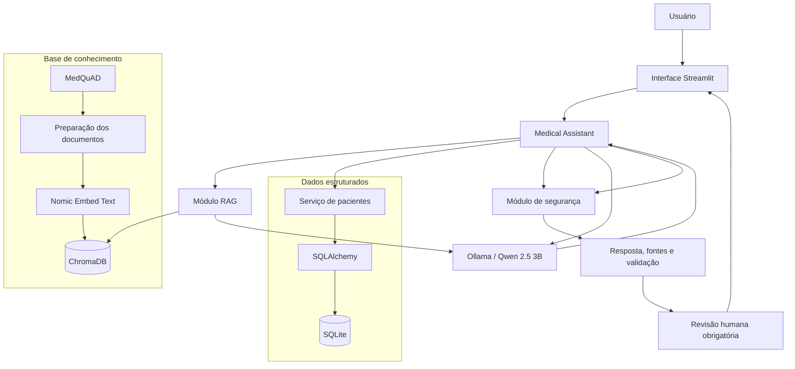

# Relatório Técnico — Medical AI Assistant

## 1. Resumo Executivo

O Medical AI Assistant é um protótipo acadêmico de assistente médico baseado em inteligência artificial, desenvolvido para demonstrar a aplicação de técnicas de recuperação aumentada por geração (Retrieval-Augmented Generation — RAG), integração com modelos de linguagem locais e consulta a dados estruturados de pacientes fictícios.

A solução permite realizar perguntas sobre informações médicas, recuperar documentos de uma base de conhecimento, gerar respostas em português e apresentar as fontes utilizadas.

O projeto também incorpora mecanismos de segurança para identificar expressões inadequadas, verificar correspondências lexicais com as fontes recuperadas e sinalizar a necessidade de revisão humana.

A aplicação foi desenvolvida em Python, utilizando LangChain, ChromaDB, Ollama, SQLite e Streamlit.

## 2. Introdução

Modelos de linguagem podem facilitar o acesso a informações médicas, mas sua utilização nesse contexto apresenta desafios relacionados à confiabilidade, rastreabilidade das informações e possibilidade de geração de conteúdo incorreto.

Uma abordagem para reduzir esses riscos é combinar modelos de linguagem com bases documentais externas, permitindo que as respostas sejam elaboradas a partir de informações recuperadas de fontes de referência.

Nesse contexto, o Medical AI Assistant foi desenvolvido como uma solução experimental que integra recuperação de conhecimento médico, processamento de linguagem natural, consulta a dados fictícios de pacientes e verificações automatizadas de segurança.

## 3. Objetivos

### 3.1. Objetivo geral

Desenvolver um assistente médico experimental capaz de recuperar informações de uma base de conhecimento, gerar respostas contextualizadas e apresentar mecanismos de segurança que apoiem a confiabilidade das informações disponibilizadas.

### 3.2. Objetivos específicos

- Implementar uma arquitetura RAG para recuperação de informações médicas.
- Utilizar uma base de conhecimento médica pública.
- Integrar um modelo de linguagem executado localmente.
- Implementar consultas a dados estruturados de pacientes fictícios.
- Apresentar fontes utilizadas na geração das respostas.
- Implementar verificações automáticas de segurança.
- Sinalizar respostas que necessitam de revisão humana.
- Disponibilizar uma interface para interação e demonstração.

## 4. Arquitetura da solução

A aplicação foi organizada em módulos para separar as responsabilidades de interface, processamento das perguntas, recuperação de documentos, geração de respostas, acesso aos dados dos pacientes e validação de segurança.

### 4.1. Componentes arquiteturais

| Componente | Responsabilidade |
|---|---|
| Streamlit | Interface de interação com o usuário |
| Assistant | Orquestração do processamento das perguntas e respostas |
| RAG | Recuperação de documentos médicos relevantes |
| ChromaDB | Armazenamento e busca vetorial |
| Nomic Embed Text | Geração de embeddings |
| Ollama / Qwen 2.5 3B | Execução local do modelo de linguagem |
| SQLite | Persistência dos dados fictícios |
| SQLAlchemy | Mapeamento objeto-relacional e acesso ao banco |
| Safety | Verificações automáticas e sinalização de revisão humana |

### 4.2. Diagrama da arquitetura



## 5. Base de conhecimento médica

### 5.1. MedQuAD

O projeto utiliza o conjunto de dados MedQuAD, que reúne perguntas e respostas relacionadas à saúde provenientes de fontes médicas reconhecidas.

A base foi utilizada como fonte de conhecimento para permitir a recuperação de informações relevantes durante o processamento das perguntas.

O conjunto original contém milhares de registros. Para adequar o processamento aos recursos computacionais disponíveis, foi realizada uma preparação dos dados e uma seleção de documentos para indexação.

### 5.2. Preparação dos documentos

O processamento da base contempla:

1. Leitura dos arquivos de origem.
2. Extração das perguntas e respostas.
3. Organização dos registros em formato estruturado.
4. Preparação dos documentos para recuperação.
5. Divisão do conteúdo em fragmentos.
6. Geração de embeddings.
7. Indexação dos fragmentos no ChromaDB.

A base processada contém 16.406 registros. A indexação vetorial utilizada na versão atual foi realizada com uma seleção de 300 registros, resultando em aproximadamente 1.347 fragmentos.

Essa estratégia reduz o consumo de memória e o tempo necessário para execução em ambiente local.

## 6. Implementação do RAG

A arquitetura RAG permite recuperar documentos relevantes antes da geração da resposta.

O módulo implementado em `src/medical_assistant/rag.py` realiza a preparação da consulta, busca vetorial, filtragem e ordenação dos documentos recuperados.

### 6.1. Etapas de recuperação

1. Recebimento da pergunta.
2. Identificação do tipo de pergunta.
3. Preparação da consulta de busca.
4. Recuperação de documentos no ChromaDB.
5. Aplicação de critérios de relevância.
6. Remoção de documentos duplicados.
7. Retorno dos documentos selecionados para o assistente.

A recuperação utiliza embeddings produzidos pelo modelo Nomic Embed Text.

O sistema também possui estratégias específicas para perguntas relacionadas à leucemia linfoblástica aguda em adultos, diferenciando consultas sobre definição e sintomas.

### 6.2. Limitações da recuperação

A qualidade da resposta depende diretamente da relevância e da completude dos documentos recuperados.

Durante os testes, foi observado que uma consulta sobre definição da doença poderia recuperar somente uma parte de um documento dividido em três partes.

Por esse motivo, a implementação sinaliza quando a resposta utiliza apenas um trecho parcial, evitando apresentar esse conteúdo como uma definição completa.

## 7. Modelo de linguagem

A geração de respostas utiliza o Ollama para executar localmente o modelo Qwen 2.5 3B.

A integração foi implementada por meio do LangChain, permitindo encaminhar perguntas e documentos recuperados ao modelo.

A configuração utiliza temperatura zero para favorecer respostas mais consistentes e um limite de tokens para controlar o tamanho das gerações.

Foram estabelecidas instruções para:

- Utilizar os documentos fornecidos como fonte de conhecimento.
- Não inventar informações clínicas.
- Não realizar diagnósticos.
- Não prescrever medicamentos ou tratamentos.
- Informar quando os documentos forem insuficientes.
- Utilizar português brasileiro.
- Não tratar dados fictícios de pacientes como fonte de conhecimento médico.

Para determinadas perguntas sobre definição e sintomas, também foram implementadas traduções controladas do conteúdo recuperado, reduzindo a dependência de geração livre do modelo.

**Observação:** o projeto utiliza um modelo pré-treinado executado localmente. Não foi realizado fine-tuning do Qwen 2.5 3B nesta versão.

## 8. Banco de dados e contexto dos pacientes

O projeto utiliza SQLite para armazenar dados fictícios de pacientes.

A camada de persistência foi implementada com SQLAlchemy, utilizando modelos para representar:

- Pacientes.
- Exames.
- Alergias.
- Condições clínicas.

Foram cadastrados três pacientes fictícios para demonstrar a integração entre a recuperação de informações médicas e a consulta a dados estruturados.

Os dados podem ser utilizados para contextualizar a interação e demonstrar consultas relacionadas a informações individuais.

Os registros não representam pacientes reais e não devem ser interpretados como informações clínicas autênticas.

## 9. Segurança e confiabilidade

Considerando a natureza sensível das informações médicas, foi implementado um módulo de segurança em `src/medical_assistant/safety.py`.

O módulo realiza verificações automáticas sobre o conteúdo gerado.

### 9.1. Verificações implementadas

- Identificação de expressões inadequadas.
- Identificação de afirmações clínicas sensíveis.
- Verificação lexical de termos da resposta em relação às fontes recuperadas.
- Identificação de ausência de documentos de referência.
- Sinalização de necessidade de revisão humana.

### 9.2. Revisão humana

A aplicação não realiza aprovação clínica automática.

Mesmo quando as verificações lexicais não identificam problemas, a resposta permanece pendente de revisão humana.

Os estados utilizados incluem:

```python
approved = False
requires_human_review = True
human_review_status = "pending"
```

A validação lexical é uma verificação automatizada limitada. Ela não comprova que uma resposta esteja semanticamente correta, clinicamente completa ou adequada para orientar decisões médicas.

### 9.3. Limitações de segurança

O módulo atual não substitui uma avaliação clínica especializada.

Também não implementa um fluxo completo de aprovação ou rejeição de respostas dentro do dashboard, nem um sistema persistente de auditoria clínica.

Essas funcionalidades são consideradas oportunidades de evolução.

## 10. Interface da aplicação

A interface foi desenvolvida utilizando Streamlit.

O dashboard permite:

- Selecionar pacientes fictícios.
- Visualizar informações cadastrais e condições registradas.
- Consultar alergias.
- Visualizar exames e seus respectivos status.
- Enviar perguntas ao assistente.
- Visualizar respostas geradas.
- Consultar as fontes utilizadas.
- Visualizar o resultado das verificações de segurança.
- Identificar a necessidade de revisão humana.

A interface foi desenvolvida para facilitar a demonstração dos componentes integrados e do fluxo de processamento da aplicação.

## 11. Avaliação e testes

Foram desenvolvidos scripts específicos para avaliar a recuperação de documentos, o funcionamento do assistente, as consultas aos pacientes e as verificações de segurança.

### 11.1. Scripts de teste

| Script | Finalidade |
|---|---|
| `test_rag.py` | Verificar a recuperação de documentos |
| `test_retrieval_quality.py` | Avaliar a qualidade da recuperação |
| `test_assistant.py` | Verificar a geração de respostas |
| `test_safety.py` | Testar as verificações de segurança |
| `test_patient_service.py` | Validar as consultas de pacientes |
| `evaluate_assistant.py` | Avaliar geração e segurança |
| `check_vector_db.py` | Verificar a base vetorial |

### 11.2. Cenários avaliados

Foram executados testes com perguntas sobre:

- Definição da leucemia linfoblástica aguda em adultos.
- Sinais e sintomas da leucemia linfoblástica aguda em adultos.

Nos resultados observados:

- A resposta sobre sintomas apresentou informações recuperadas da fonte médica.
- A resposta sobre definição utilizou conteúdo recuperado, com indicação explícita de que o documento disponível correspondia apenas à terceira parte de um conjunto de três partes.
- As verificações lexicais não identificaram problemas nos dois cenários avaliados.
- A aprovação automática permaneceu desabilitada.
- A revisão humana permaneceu obrigatória.

### 11.3. Interpretação dos resultados

Os resultados demonstram o funcionamento integrado dos componentes de recuperação, geração e verificação lexical nos cenários testados.

Entretanto, a ausência de problemas lexicais não representa comprovação de precisão clínica.

A avaliação realizada é experimental e possui escopo limitado. São necessários mais cenários, métricas de recuperação e avaliação especializada para determinar a confiabilidade da solução.

## 12. Tecnologias utilizadas

| Tecnologia | Aplicação |
|---|---|
| Python 3.11 | Linguagem principal |
| LangChain | Integração e orquestração do modelo |
| Ollama | Execução local do modelo de linguagem |
| Qwen 2.5 3B | Geração de respostas |
| Nomic Embed Text | Geração de embeddings |
| ChromaDB | Banco vetorial |
| SQLite | Banco de dados relacional |
| SQLAlchemy | Persistência e consultas estruturadas |
| Streamlit | Interface web |
| MedQuAD | Base de conhecimento médica |

## 13. Limitações e trabalhos futuros

A versão atual é um protótipo acadêmico e possui limitações que devem ser consideradas.

Entre as principais oportunidades de evolução estão:

- Ampliar a cobertura da base vetorial.
- Melhorar a recuperação de documentos relacionados e complementares.
- Implementar recuperação de documentos por partes relacionadas.
- Avaliar modelos de linguagem e estratégias de geração alternativas.
- Realizar fine-tuning, caso haja dados e metodologia adequados.
- Avaliar a utilização de LangGraph para fluxos mais complexos.
- Implementar auditoria persistente das interações.
- Desenvolver um fluxo de aprovação humana dentro da aplicação.
- Ampliar os testes automatizados.
- Realizar avaliação semântica e clínica com profissionais qualificados.

Essas funcionalidades não são consideradas implementadas na versão atual.

## 14. Conclusão

O Medical AI Assistant demonstra a integração de recuperação aumentada por geração, modelos de linguagem locais, dados estruturados e verificações automatizadas de segurança em um protótipo de assistente médico.

A solução permite consultar informações médicas provenientes de uma base de conhecimento, contextualizar interações com dados fictícios de pacientes e apresentar as fontes utilizadas na geração das respostas.

A implementação também evidencia a importância de limitar a autonomia de sistemas de inteligência artificial em contextos médicos, mantendo a revisão humana como requisito obrigatório.

Apesar dos resultados funcionais obtidos nos testes experimentais, o sistema não está validado para uso clínico ou tomada de decisão médica.

## 15. Referências

BEN ABACHA, Asma; DEMNER-FUSHMAN, Dina. A Question-Entailment Approach to Question Answering. *BMC Bioinformatics*, 2019.

MedQuAD — Medical Question Answering Dataset. Disponível em: https://github.com/abachaa/MedQuAD

LangChain Documentation. Disponível em: https://python.langchain.com/

Ollama Documentation. Disponível em: https://ollama.com/

ChromaDB Documentation. Disponível em: https://docs.trychroma.com/

Streamlit Documentation. Disponível em: https://docs.streamlit.io/