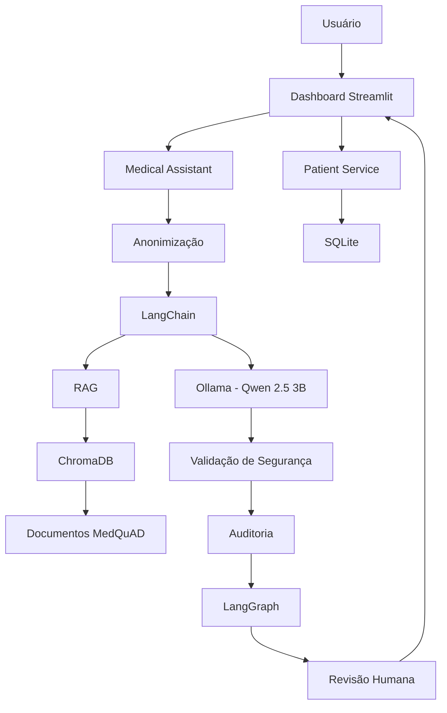

# Relatório Técnico — Medical AI Assistant

## 1. Resumo Executivo

O Medical AI Assistant é um protótipo acadêmico de assistente de informação médica baseado em Inteligência Artificial Generativa, Retrieval-Augmented Generation (RAG), LangChain e LangGraph.

A solução recupera informações de uma base de conhecimento médica, utiliza modelos de linguagem locais para geração de respostas e apresenta as fontes utilizadas. Também integra dados fictícios de pacientes armazenados em SQLite.

Foram implementados mecanismos de anonimização, auditoria, verificações automatizadas de segurança e encaminhamento obrigatório para revisão humana.

O projeto também contempla um experimento de fine-tuning utilizando LoRA, com modelo e conjunto de treinamento independentes do modelo principal da aplicação.

A solução foi desenvolvida em Python e utiliza Streamlit, ChromaDB, Ollama, SQLAlchemy, PyTorch, Transformers e PEFT.

**Importante:** trata-se de um protótipo educacional. Não possui validação clínica e não deve ser utilizado para diagnóstico ou decisões médicas.

## 2. Introdução

Modelos de linguagem podem facilitar o acesso a informações médicas, mas sua utilização nesse contexto apresenta desafios relacionados à confiabilidade, rastreabilidade das informações e possibilidade de geração de conteúdo incorreto.

Uma abordagem para reduzir parte desses riscos é combinar modelos de linguagem com bases documentais externas, permitindo que as respostas sejam elaboradas com apoio de informações recuperadas.

Nesse contexto, o Medical AI Assistant integra recuperação de conhecimento médico, processamento de linguagem natural, consulta a dados fictícios de pacientes e mecanismos de segurança.

O projeto também explora técnicas de anonimização, auditoria e orquestração de processos com LangGraph.

## 3. Objetivos

### 3.1 Objetivo geral

Desenvolver um assistente experimental capaz de recuperar informações médicas, gerar respostas contextualizadas e apresentar mecanismos de segurança e rastreabilidade.

### 3.2 Objetivos específicos

- Implementar uma arquitetura RAG para recuperação de informações médicas.
- Utilizar uma base de conhecimento médica pública.
- Integrar um modelo de linguagem executado localmente.
- Utilizar LangChain para integração com o LLM.
- Utilizar LangGraph para orquestração do workflow.
- Consultar dados estruturados de pacientes fictícios.
- Implementar anonimização de informações identificáveis.
- Registrar eventos para auditoria.
- Implementar verificações automatizadas de segurança.
- Exigir revisão humana das respostas.
- Experimentar fine-tuning utilizando LoRA.
- Disponibilizar uma interface de interação com Streamlit.
- Desenvolver testes automatizados com Pytest.

## 4. Arquitetura da solução

A aplicação foi organizada em módulos independentes, separando interface, processamento, recuperação de documentos, geração de respostas, persistência de dados, segurança e auditoria.

### 4.1 Componentes arquiteturais

| Componente | Responsabilidade |
|---|---|
| Streamlit | Interface de interação |
| Assistant | Coordenação do processamento das perguntas |
| LangChain | Integração com o modelo de linguagem |
| LangGraph | Orquestração do fluxo de processamento |
| RAG | Recuperação de documentos relevantes |
| ChromaDB | Armazenamento e busca vetorial |
| MedQuAD | Base de conhecimento médica |
| Ollama | Execução local dos modelos |
| Qwen 2.5 3B | Modelo principal de geração |
| Nomic Embed Text | Geração de embeddings |
| SQLite | Persistência dos dados fictícios |
| SQLAlchemy | Mapeamento objeto-relacional |
| Anonymization | Mascaramento de dados identificáveis |
| Audit | Registro de eventos e erros |
| Safety | Verificações lexicais e sinalização de riscos |
| Patient Service | Consulta de pacientes fictícios |

### 4.2 Diagrama da arquitetura



### 4.3 Fluxo de processamento

1. O usuário envia uma pergunta pela interface.
2. O sistema prepara e anonimiza a pergunta e o contexto do paciente.
3. A camada RAG recupera documentos relevantes no ChromaDB.
4. O assistente utiliza os documentos recuperados para elaborar a resposta.
5. Perguntas específicas sobre sintomas e definições podem utilizar traduções controladas do conteúdo recuperado.
6. Outras perguntas podem ser encaminhadas ao modelo local por meio do LangChain.
7. O módulo Safety executa verificações automatizadas.
8. O módulo Audit registra os eventos do processamento.
9. O LangGraph orquestra o fluxo e sinaliza a necessidade de revisão humana.
10. A interface apresenta a resposta, as fontes e o estado da revisão.

## 5. Base de conhecimento médica

### 5.1 MedQuAD

O projeto utiliza o conjunto de dados MedQuAD (Medical Question Answering Dataset), que reúne perguntas e respostas relacionadas à saúde provenientes de fontes médicas.

A base foi utilizada como fonte de conhecimento para permitir a recuperação de informações relevantes durante o processamento das perguntas.

O conjunto processado contém aproximadamente 16.406 registros.

### 5.2 Preparação dos documentos

O processamento contempla:

1. Leitura dos arquivos XML.
2. Extração de perguntas e respostas.
3. Organização dos registros e metadados.
4. Remoção de registros inválidos.
5. Preparação dos documentos.
6. Divisão do conteúdo em fragmentos.
7. Geração de embeddings.
8. Indexação no ChromaDB.

A indexação vetorial da versão atual utiliza uma seleção limitada de 300 registros, resultando em aproximadamente 1.347 fragmentos.

Essa seleção foi utilizada para adequar o processamento aos recursos computacionais disponíveis.

## 6. Implementação do RAG

A arquitetura RAG recupera documentos relevantes antes da geração da resposta.

O módulo `src/medical_assistant/rag.py` realiza a busca vetorial utilizando embeddings produzidos pelo Nomic Embed Text.

### 6.1 Etapas de recuperação

1. Recebimento da pergunta.
2. Preparação da consulta.
3. Geração ou utilização dos embeddings.
4. Busca semântica no ChromaDB.
5. Recuperação dos documentos relevantes.
6. Retorno dos documentos ao assistente.

O assistente utiliza os documentos recuperados como contexto para elaborar as respostas e apresentar as fontes correspondentes.

### 6.2 Estratégias de resposta

Foram implementadas estratégias específicas para perguntas sobre sintomas e definições médicas.

Para esses casos, o sistema identifica expressões presentes nos documentos recuperados e utiliza traduções controladas para produzir respostas em português.

Essa estratégia reduz a dependência de geração livre em determinados cenários.

### 6.3 Limitações da recuperação

A qualidade da resposta depende da relevância e da completude dos documentos recuperados.

Durante os testes, foi observado que uma consulta sobre definição poderia recuperar somente uma parte de um documento dividido em três partes.

Por esse motivo, a implementação identifica esse cenário e apresenta uma observação sobre a limitação do trecho disponível.

A base vetorial atual possui cobertura limitada e não representa a totalidade do conjunto MedQuAD.

## 7. Modelo de linguagem e LangChain

A geração de respostas utiliza o Ollama para executar localmente o modelo Qwen 2.5 3B.

A integração foi implementada por meio do LangChain, utilizando `ChatOllama` para encaminhar o prompt ao modelo.

A configuração utiliza:

- Modelo: Qwen 2.5 3B.
- Temperatura: zero.
- Limite de geração: 350 tokens.
- Execução local pelo Ollama.

As instruções enviadas ao modelo incluem:

- Utilizar exclusivamente os documentos fornecidos como fonte de conhecimento.
- Não inventar informações clínicas.
- Não realizar diagnósticos.
- Não prescrever medicamentos ou tratamentos.
- Informar quando os documentos forem insuficientes.
- Responder em português brasileiro.
- Não utilizar o contexto do paciente como fonte de conhecimento médico.

A integração também foi testada com modelos simulados nos testes automatizados, permitindo verificar o comportamento do processamento sem depender de chamadas reais ao Ollama.

## 8. Orquestração com LangGraph

O módulo `src/medical_assistant/workflow.py` implementa um fluxo utilizando LangGraph.

O estado do workflow armazena informações como:

- Pergunta.
- Contexto do paciente.
- Resultado da geração.
- Estado do processamento.
- Informações de erro.

### 8.1 Etapas do workflow

| Etapa | Responsabilidade |
|---|---|
| `prepare_consultation` | Preparar os dados da consulta |
| `generate_response` | Executar a geração da resposta |
| `route_after_generation` | Definir o próximo caminho do fluxo |
| `human_review` | Sinalizar a necessidade de revisão humana |
| `complete_workflow` | Finalizar o fluxo quando não houver necessidade de revisão |

### 8.2 Revisão humana

No fluxo atual do assistente, as respostas permanecem pendentes de revisão humana.

Os estados de segurança incluem:

```python
approved = False
requires_human_review = True
human_review_status = "pending"
```

O workflow também possui um caminho de conclusão condicional, testado de forma isolada.

O protótipo não implementa um mecanismo persistente de aprovação ou rejeição por profissionais de saúde.

## 9. Banco de dados e contexto dos pacientes

O projeto utiliza SQLite para armazenar dados fictícios de pacientes.

A camada de persistência utiliza SQLAlchemy e contempla entidades relacionadas a:

- Pacientes.
- Exames.
- Alergias.
- Condições clínicas.

Os dados são utilizados para demonstrar a integração entre informações estruturadas e o assistente.

Todos os registros empregados na demonstração são fictícios e não representam pacientes reais.

## 10. Anonimização de dados

O módulo `src/medical_assistant/anonymization.py` implementa funções para mascaramento de informações identificáveis.

### 10.1 Dados tratados

A implementação contempla padrões para:

- E-mails.
- CPF.
- CNPJ.
- Telefones.
- CEP.
- Nomes identificados em campos específicos.
- Datas de nascimento identificadas em campos específicos.

### 10.2 Aplicação no processamento

Antes da recuperação de documentos e da geração de respostas, a pergunta e o contexto do paciente passam pelo processo de anonimização.

O tratamento também é aplicado recursivamente a estruturas como dicionários, listas e tuplas.

### 10.3 Limitações

A implementação utiliza padrões e regras de identificação. Portanto, não garante anonimização completa.

Informações pessoais em texto livre que não correspondam aos padrões implementados podem permanecer no conteúdo.

A solução é uma camada demonstrativa de proteção e não representa certificação de conformidade com LGPD, HIPAA ou outros padrões regulatórios.

## 11. Auditoria e rastreabilidade

O módulo `src/medical_assistant/audit.py` registra eventos do processamento em arquivos JSONL.

### 11.1 Eventos registrados

Entre os eventos contemplados estão:

- Início de consulta.
- Recuperação de documentos.
- Geração de resposta.
- Validação de segurança.
- Necessidade de revisão humana.
- Conclusão da consulta.
- Erros de processamento.

### 11.2 Proteção dos registros

A implementação utiliza SHA-256 para representar referências de pacientes e perguntas por meio de hashes.

Os registros de erro evitam armazenar a mensagem detalhada da exceção, reduzindo o risco de exposição acidental de informações.

Os arquivos são armazenados localmente no diretório:

```text
outputs/audit/
```

A auditoria é uma implementação demonstrativa e não substitui um sistema corporativo de gestão de logs, controle de acesso ou retenção de dados.

## 12. Fine-tuning experimental com LoRA

Foi desenvolvido um experimento de fine-tuning utilizando a técnica LoRA (Low-Rank Adaptation), por meio das bibliotecas Transformers e PEFT.

O experimento utiliza um modelo separado do modelo principal da aplicação.

### 12.1 Configuração experimental

| Parâmetro | Configuração |
|---|---|
| Modelo base | HuggingFaceTB/SmolLM2-135M-Instruct |
| Técnica | LoRA |
| Biblioteca de treinamento | Transformers e PEFT |
| Framework | PyTorch |
| Dispositivo | CPU |
| Amostra de treinamento | 128 exemplos |
| Amostra de validação | 32 exemplos |
| Épocas | 1 |
| Batch size | 1 |
| Learning rate | 0.0002 |
| Sequência máxima | 256 tokens |
| Rank LoRA | 4 |
| Alpha LoRA | 8 |
| Dropout LoRA | 0.05 |

O treinamento foi realizado com os módulos de projeção `q_proj` e `v_proj`.

### 12.2 Dataset

O script de preparação do dataset processou os registros MedQuAD e gerou:

- 16.208 exemplos válidos.
- 14.588 exemplos de treinamento.
- 1.620 exemplos de validação.
- 154 registros rejeitados.

Para o experimento de treinamento, foi utilizada uma amostra reduzida de 128 exemplos de treinamento e 32 de validação, considerando os recursos computacionais disponíveis.

### 12.3 Resultado do treinamento

O treinamento apresentou:

- Loss de treinamento: aproximadamente 2,2167.
- Loss de validação: aproximadamente 2,0599.
- Parâmetros treináveis: 230.400.
- Total de parâmetros: 134.745.408.
- Proporção de parâmetros treináveis: aproximadamente 0,171%.

O adaptador foi salvo em:

```text
outputs/finetuning/smollm2-lora/
```

Os relatórios foram armazenados em:

```text
outputs/finetuning/
```

### 12.4 Avaliação e limitações

Foi realizada uma comparação experimental entre o modelo base e o modelo com adaptador LoRA.

As respostas apresentaram diferenças de conteúdo, mas os resultados não permitem concluir que houve melhoria consistente da qualidade.

O experimento demonstra a execução técnica do fine-tuning, mas não comprova precisão médica, superioridade do modelo ajustado ou adequação para uso clínico.

O modelo experimental não substitui o Qwen 2.5 3B utilizado pelo assistente principal e não está integrado automaticamente ao fluxo de produção do protótipo.

## 13. Segurança e confiabilidade

O módulo `src/medical_assistant/safety.py` realiza verificações automatizadas sobre o conteúdo produzido.

### 13.1 Verificações implementadas

- Identificação de expressões inadequadas.
- Identificação de afirmações clínicas sensíveis.
- Verificação lexical de termos em relação às fontes.
- Identificação de respostas sem documentos recuperados.
- Sinalização de necessidade de revisão humana.

### 13.2 Revisão humana obrigatória

Mesmo quando as verificações automáticas não identificam problemas, a resposta permanece pendente de revisão humana.

As verificações lexicais não comprovam precisão semântica, factual ou clínica.

A solução não implementa aprovação clínica automática nem um processo persistente de aprovação ou rejeição no dashboard.

## 14. Interface da aplicação

A interface foi desenvolvida com Streamlit.

O dashboard permite:

- Selecionar pacientes fictícios.
- Visualizar informações dos pacientes.
- Consultar alergias e condições cadastradas.
- Visualizar exames e seus status.
- Enviar perguntas ao assistente.
- Visualizar respostas.
- Consultar as fontes recuperadas.
- Identificar a necessidade de revisão humana.

A interface facilita a demonstração dos componentes integrados e do fluxo de processamento.

## 15. Testes automatizados

O projeto utiliza Pytest para validar os principais componentes.

A suíte automatizada está organizada no diretório `tests/`.

### 15.1 Arquivos de teste

| Arquivo | Objetivo |
|---|---|
| `test_anonymization.py` | Validar anonimização e tratamento recursivo |
| `test_audit.py` | Validar hashes e registros de auditoria |
| `test_langchain_integration.py` | Validar os fluxos do assistente e a integração simulada com LangChain |
| `test_safety.py` | Validar verificações de segurança |
| `test_workflow.py` | Validar o fluxo e o roteamento LangGraph |

### 15.2 Cenários cobertos

Os testes verificam:

- Remoção de e-mails, CPF, CNPJ e CEP.
- Anonimização de estruturas aninhadas.
- Geração de hashes.
- Registro de eventos de auditoria.
- Tratamento seguro de erros.
- Rejeição de perguntas vazias.
- Comportamento quando não existem documentos recuperados.
- Respostas sobre sintomas e definições.
- Uso de contexto anonimizado antes da geração.
- Encaminhamento para revisão humana.
- Roteamento condicional do LangGraph.

### 15.3 Resultado dos testes

Na execução registrada durante o desenvolvimento:

```text
========================
26 passed in 10.00s
========================
```

Os 26 testes foram aprovados.

Os testes de integração com LangChain utilizam mocks para simular o RAG e o modelo de linguagem, permitindo verificar os comportamentos sem depender de inferência real pelo Ollama.

Os testes automatizados representam os cenários implementados e não constituem validação clínica ou garantia de ausência de erros.

## 16. Tecnologias utilizadas

| Tecnologia | Aplicação |
|---|---|
| Python 3.11 | Linguagem principal |
| LangChain | Integração com o LLM |
| LangGraph | Orquestração do workflow |
| Ollama | Inferência local |
| Qwen 2.5 3B | Modelo principal |
| Nomic Embed Text | Embeddings |
| ChromaDB | Banco vetorial |
| SQLite | Persistência relacional |
| SQLAlchemy | ORM |
| Streamlit | Interface |
| Hugging Face Transformers | Fine-tuning experimental |
| PEFT / LoRA | Ajuste eficiente de parâmetros |
| PyTorch | Treinamento |
| Pytest | Testes automatizados |

## 17. Limitações e trabalhos futuros

A versão atual é um protótipo acadêmico e apresenta limitações:

- A base vetorial contém uma seleção limitada de documentos.
- A qualidade depende dos documentos recuperados.
- A validação de segurança é predominantemente lexical.
- A anonimização não garante remoção de toda informação identificável.
- O modelo pode gerar respostas incorretas ou incompletas.
- O fine-tuning não foi validado para uso clínico.
- O adaptador LoRA não está integrado ao modelo principal.
- Não existe aprovação clínica automática.
- Não existe fluxo persistente de aprovação ou rejeição humana.
- A auditoria não substitui uma solução corporativa de observabilidade e governança.

Como evolução, podem ser considerados:

- Ampliar a cobertura da base vetorial.
- Implementar avaliação de recuperação com métricas específicas.
- Melhorar a recuperação de documentos complementares.
- Avaliar diferentes modelos e estratégias de geração.
- Ampliar os testes automatizados.
- Implementar revisão humana persistente.
- Aprimorar o monitoramento e a auditoria.
- Realizar avaliação especializada das respostas.

## 18. Conclusão

O Medical AI Assistant demonstra a integração de Inteligência Artificial Generativa, RAG, LangChain, LangGraph e modelos locais em uma aplicação acadêmica de informação médica.

A solução combina recuperação semântica, consulta a dados estruturados, anonimização, auditoria e verificações automatizadas de segurança.

O projeto também apresenta um experimento de fine-tuning com LoRA e uma suíte de testes automatizados para validar os principais componentes.

Os resultados demonstram o funcionamento técnico dos fluxos implementados nos cenários avaliados. Entretanto, a solução não possui validação clínica e mantém a revisão humana como requisito obrigatório.

## 19. Referências

BEN ABACHA, Asma; DEMNER-FUSHMAN, Dina. A Question-Entailment Approach to Question Answering. BMC Bioinformatics, 2019.

MedQuAD — Medical Question Answering Dataset. Disponível em: https://github.com/abachaa/MedQuAD

LangChain Documentation. Disponível em: https://python.langchain.com/

LangGraph Documentation. Disponível em: https://langchain-ai.github.io/langgraph/

Ollama Documentation. Disponível em: https://ollama.com/

ChromaDB Documentation. Disponível em: https://docs.trychroma.com/

Streamlit Documentation. Disponível em: https://docs.streamlit.io/

Hugging Face Documentation. Disponível em: https://huggingface.co/docs

PEFT Documentation. Disponível em: https://huggingface.co/docs/peft
